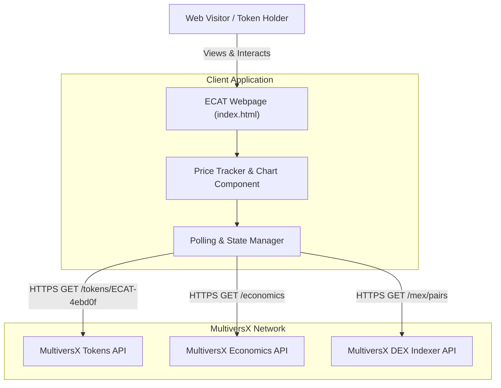

# 001-ecat-price-tracker - System Context

## System Overview
The ECAT Price Tracker is a client-side component integrated into the existing $ECAT landing page. It provides real-time market data, price conversion (USD and EGLD), market cap, and an interactive SVG historical chart for $ECAT (`ECAT-4ebd0f`) by communicating with MultiversX public APIs.

## Context Diagram

## External Integrations
- **MultiversX Token API (`https://api.multiversx.com/tokens/ECAT-4ebd0f`)**: Primary source for token metadata, circulating supply, decimal scale, and indexer price.
- **MultiversX Economics API (`https://api.multiversx.com/economics`)**: Source for global EGLD price in USD to calculate and verify EGLD/ECAT ratio.
- **MultiversX Explorer / DEX (`https://explorer.multiversx.com/tokens/ECAT-4ebd0f`)**: Deep link destinations for on-chain proof and swap actions.

## High-Level Constraints
- Pure client-side JavaScript (ES6+) with zero build requirements or runtime dependencies.
- CORS-compliant public endpoint usage without authentication credentials.
- Retain existing dark cosmic styling, responsive typography, and layout of the landing page.

## Key NFR Goals
- Initial price metric render under 500ms.
- 100% graceful handling of network drops or pre-market unindexed statuses.
- Tab visibility-aware background polling to preserve device battery and network bandwidth.
