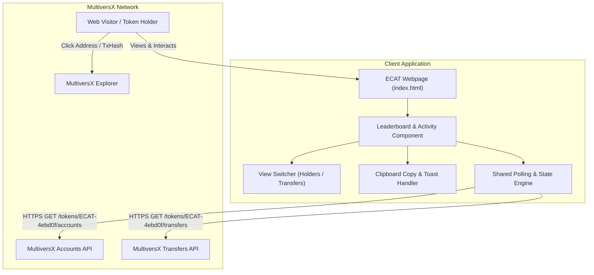

# 002-holder-leaderboard - System Context

## System Overview
The Holder Leaderboard & Activity Feed is a client-side component integrated into the $ECAT landing page directly beneath the Price Tracker. It visualizes the distribution of ECAT tokens among the top 10 holders and tracks recent token transfers in real time by connecting to the MultiversX public API.

## Context Diagram

## External Integrations
- **MultiversX Accounts API (`https://api.multiversx.com/tokens/ECAT-4ebd0f/accounts?size=10`)**: Supplies top holder balances, rank ordering, and account addresses.
- **MultiversX Transfers API (`https://api.multiversx.com/tokens/ECAT-4ebd0f/transfers?size=10`)**: Supplies timestamped on-chain transactions, sender/receiver addresses, and transaction hashes.
- **MultiversX Explorer (`https://explorer.multiversx.com/`)**: External verification destinations for account details and transaction verification.

## High-Level Constraints
- Zero external build dependencies or npm packages (pure vanilla web standard).
- Seamless styling integration with existing cosmic dark palette (`#070B12`, cyan `#23F7DD`, indigo `#6366F1`).
- Shared background polling cycle with the Price Tracker to minimize redundant network requests.
