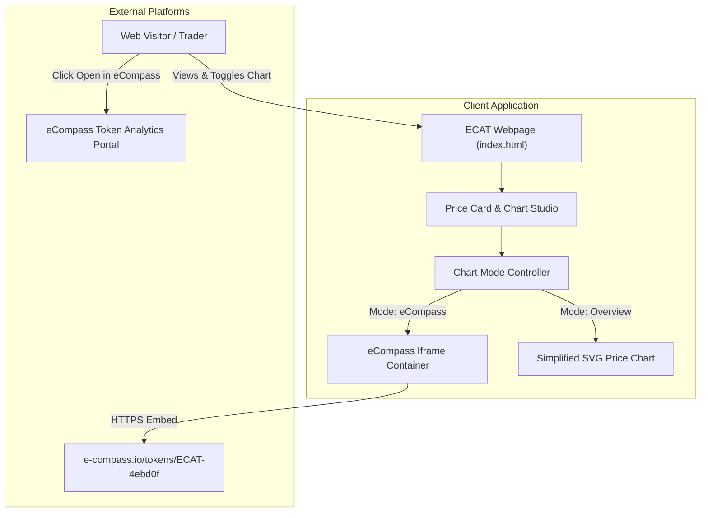

# 003-ecompass-chart - System Context

## System Overview
The eCompass Chart Module integrates the live MultiversX DEX candlestick and liquidity pool charting engine (`e-compass.io`) directly into the $ECAT landing page. It introduces an interactive view mode switcher in the price card, allowing visitors to alternate between the comprehensive eCompass candlestick trading terminal and the simplified SVG trajectory curve.

## Context Diagram

## External Integrations
- **eCompass MultiversX Token Portal (`https://e-compass.io/tokens/ECAT-4ebd0f`)**: Source for live interactive DEX candlestick charts, price history, and liquidity analytics.
- **MultiversX Explorer**: Deep link reference for on-chain contract and asset verification.

## High-Level Constraints
- Zero external build tool dependencies.
- Secure iframe sandboxing allowing necessary script execution and popups while protecting host DOM.
- Seamless cosmic dark styling (`#070B12`, cyan `#23F7DD`) with responsive height adjustment.
